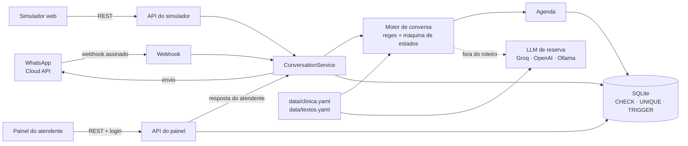

# Plano de desenvolvimento: assistente virtual de clínica no WhatsApp com IA

Projeto de portfólio e base reutilizável (de prateleira). Este é o roteiro de trabalho: marcar `[x]` ao concluir cada item. Criado em 12/11/2026.

## Como vamos trabalhar

- Uma fase por vez, na ordem. Uma fase só fecha com `ruff` e `pytest` verdes.
- Ao fechar uma fase: revisão, checkboxes atualizados, commit e tag (`v0.1.0` = Fase 1 … `v1.0.0` = Fase 6).
- Decisão nova ou mudança de escopo entra na seção 2.

## 1. Objetivo e princípios

Atendente virtual de uma clínica **fictícia e genérica** (sem marca própria). O cliente conversa pelo WhatsApp (ou pelo simulador web) e o bot informa, agenda, consulta, cancela e passa para um humano quando precisa. Quem avalia precisa ver funcionando em poucos minutos, sem configurar nada.

1. **Núcleo determinístico, IA só como reserva.** Regex em português + máquina de estados resolvem o roteiro. O LLM só responde perguntas fora dele e nunca executa ações (não agenda, não cancela).
2. **Integridade garantida pelo banco.** Regras de agenda em `CHECK`, índices únicos parciais e triggers. O código valida antes para dar boa experiência; o banco é a última barreira, inclusive contra dois clientes disputando o mesmo horário.
3. **Um motor, vários canais.** WhatsApp, simulador e painel passam pelo mesmo serviço de conversa: o simulador demonstra exatamente a lógica de produção.
4. **Funciona sem nada configurado.** Sem `.env`: modo demo com dados fictícios pré-carregados; WhatsApp e IA desligados e sinalizados na interface.
5. **Projeto base, de prateleira.** Nada de nome ou marca no código: dados do negócio e mensagens do bot ficam em `data/clinica.yaml` e `data/textos.yaml`, com conteúdo fictício. Adaptar para um cliente = editar esses arquivos (ou montar outra pasta de dados), sem mexer no código.

## 2. Decisões técnicas

| Tema | Decisão | Motivo |
|---|---|---|
| Ambiente | Python 3.14 + `uv` (`pyproject.toml` + `uv.lock`) | Já instalados; lock reprodutível e rápido no Docker |
| Web | FastAPI + Uvicorn, OpenAPI em `/docs` | Requisito; API documentada sem esforço |
| Banco | SQLite (WAL) com SQLAlchemy 2.0 + Alembic | Zero configuração; Alembic prepara a ida para PostgreSQL |
| Dados da clínica | YAML validado por Pydantic na inicialização | Legível e comentável; arquivo errado falha cedo com mensagem clara |
| Textos do bot | `data/textos.yaml` com placeholders (`{clinica}`, `{data}`…) | Tom e mensagens ajustáveis por cliente sem tocar no código |
| Distribuição | Uma instância por cliente (single-tenant), configurada por arquivos e variáveis de ambiente | Simples; multi-tenant só se virar SaaS |
| Entendimento | Normalização + regex PT-BR + parsers de data/hora | Previsível, testável, custo zero |
| Conversa | Máquina de estados; estado e contexto persistidos por conversa | Sobrevive a reinício; testável sem HTTP |
| IA | Cliente compatível com OpenAI, `base_url` configurável | Groq, OpenAI ou Ollama trocando só variáveis de ambiente |
| Front | HTML/CSS/JS puro servido pelo FastAPI; atualização por polling | Sem build e sem framework |
| Painel | Usuário no banco com hash Argon2; sessão em cookie assinado | Simples e seguro o suficiente |
| Testes | pytest, pytest-cov, respx (mock de HTTP) | Cobertura medida; integrações externas mockadas |
| TestClient | `httpx` com o aviso de depreciação do Starlette 1.10 filtrado no pytest (ele prefere `httpx2`) | `httpx` já é usado no envio e pelo respx; reavaliar `httpx2` quando o respx suportar |
| Qualidade | ruff (lint + format) e GitHub Actions | CI verde visível no repositório |
| Entrega | Dockerfile (usuário não-root) + docker-compose | Sobe com um comando |
| Idioma | Código em inglês; textos do bot, docs e README em português | Padrão de mercado; público brasileiro |

## 3. Arquitetura



Caminho de uma mensagem recebida:

1. O canal recebe. No WhatsApp: valida a assinatura, responde 200 na hora e processa em background.
2. `ConversationService` grava a mensagem de entrada. O id externo é único no banco, então uma mensagem reenviada pela Meta é descartada aqui.
3. Conversa com humano: nada mais acontece (a mensagem aparece no painel).
4. Motor de conversa: comandos globais → passo atual do fluxo → intenções/FAQ → IA (se ligada) → "não entendi".
5. Respostas gravadas com o autor (`bot`, `ai`, `agent`) e entregues pelo canal: API de envio da Meta ou resposta/polling do simulador.

Rotas previstas:

| Rota | Função |
|---|---|
| `GET /` | Simulador |
| `GET /admin` | Painel |
| `GET /health`, `GET /api/status` | Saúde; flags de demo/WhatsApp/IA para a interface |
| `POST /api/simulator/messages` | Envia mensagem; retorna respostas + dados de depuração |
| `GET /api/simulator/messages?contact=&after=` | Polling (respostas do atendente) |
| `POST /api/simulator/reset` | Reinicia a conversa |
| `GET` e `POST /webhook/whatsapp` | Verificação e recebimento de mensagens da Meta |
| `POST /api/admin/login`, `POST /api/admin/logout` | Sessão do painel |
| `GET /api/admin/conversations?status=`, `GET /api/admin/conversations/{id}` | Fila, lista e histórico |
| `POST /api/admin/conversations/{id}/assign`, `/reply`, `/release` | Assumir, responder, devolver ao bot |
| `GET /api/admin/appointments`, `POST /api/admin/appointments/{id}/cancel` | Agenda |

## 4. Estrutura do repositório

```
bot-whatsapp-portfolio/
├── app/
│   ├── main.py            # create_app(), lifespan, rotas, arquivos estáticos
│   ├── config.py          # Settings (pydantic-settings) e detecção do modo demo
│   ├── clock.py           # relógio injetável no fuso da clínica
│   ├── clinic/            # models Pydantic e carga de clinica.yaml e textos.yaml
│   ├── db/                # engine, models, hooks de conexão, sync do YAML, dados demo
│   ├── scheduling/        # horários livres, agendar, consultar, cancelar
│   ├── nlu/               # normalização, intenções (regex), parsers
│   ├── conversation/      # estados, textos do bot, motor, ConversationService
│   ├── ai/                # cliente LLM, prompt, NullLLM/FakeLLM
│   ├── channels/          # whatsapp (webhook, assinatura, envio) e simulator
│   ├── admin/             # autenticação e API do painel
│   └── static/            # simulator/ e admin/ (HTML/CSS/JS puro)
├── data/                  # ponto de customização por cliente
│   ├── clinica.yaml       # dados fictícios do negócio
│   └── textos.yaml        # mensagens do bot com placeholders
├── migrations/            # Alembic; constraints e triggers escritos à mão
├── scripts/eval_llm.py    # avaliação manual da IA
├── tests/                 # unit/, db/, conversation/, api/
├── docs/                  # whatsapp-setup.md, img/
├── var/                   # banco SQLite em runtime (fora do git)
├── .github/workflows/ci.yml
├── Dockerfile, docker-compose.yml, .env.example
├── pyproject.toml, uv.lock
└── README.md, PLANO.md
```

## 5. Modelo de dados e regras no banco

| Tabela | Campos principais |
|---|---|
| `specialties` | id, slug (único), name, professional, price_cents, active. Sincronizada do YAML |
| `business_hours` | weekday (0–6), open_min, close_min (minutos desde 00:00; vários intervalos por dia permitem pausa de almoço). Sincronizada do YAML |
| `schedule_settings` | linha única: min_advance_minutes |
| `appointments` | id, specialty_id, patient_phone, patient_name, starts_at (horário local da clínica), status (`confirmed`/`cancelled`), channel, created_at, cancelled_at |
| `conversations` | id, channel, contact (único por canal), display_name, status (`bot`/`waiting_human`/`human`), state, context (JSON), priority, handoff_reason, assigned_to, unknown_count, last_inbound_at |
| `messages` | id, conversation_id, direction, author (`customer`/`bot`/`ai`/`agent`), text, external_id (único quando presente: deduplicação do webhook), created_at |
| `users` | id, username (único), password_hash, name |
| `llm_calls` (Fase 4) | conversation_id, latência, resultado. Base para limites e métricas |

Regras de agenda garantidas no banco (cada uma com teste que tenta violá-la e espera erro):

| Regra | Mecanismo |
|---|---|
| Intervalos de 30 min | `CHECK` nos minutos de `starts_at` (00 ou 30, segundos zerados) |
| Sem horário duplicado | Índice único parcial `(specialty_id, starts_at) WHERE status = 'confirmed'`; cancelar libera o horário |
| Paciente sem duas consultas no mesmo horário | Índice único parcial `(patient_phone, starts_at) WHERE status = 'confirmed'` |
| Horário de funcionamento | Trigger `BEFORE INSERT/UPDATE`: exige linha em `business_hours` para o dia da semana com início ≥ abertura e início + 30 ≤ fechamento |
| Antecedência mínima | Trigger `BEFORE INSERT`: `starts_at` ≥ agora (fuso da clínica) + antecedência |
| Domínio | `CHECK` em status, preço ≥ 0 e nome não vazio; chaves estrangeiras ativas |

Observações:

- "Agora" no trigger vem da função SQL `clinic_now()`, registrada pela aplicação em cada conexão SQLite e alimentada pelo relógio injetável (`America/Sao_Paulo`). Banco e código usam o mesmo relógio, e o trigger fica testável. No PostgreSQL vira `now() AT TIME ZONE 'America/Sao_Paulo'`.
- Disputa pelo mesmo horário: o índice único decide; o serviço captura o `IntegrityError` e o bot oferece outros horários.
- Toda conexão SQLite: `foreign_keys=ON` (o SQLite não aplica FKs por padrão), `journal_mode=WAL`, `busy_timeout`.

## 6. Motor de conversa

**Estados:** `MENU`, `BOOK_SPECIALTY`, `BOOK_DAY`, `BOOK_TIME`, `BOOK_NAME`, `BOOK_CONFIRM`, `CANCEL_PICK`, `CANCEL_CONFIRM`. O status da conversa (`bot`, `waiting_human`, `human`) é separado do estado: fora de `bot`, o bot fica em silêncio.

**Ordem de avaliação de cada mensagem:**

1. Normalizar: minúsculas, sem acentos, espaços colapsados.
2. Comandos globais, válidos em qualquer passo:
   - `atendente`, `humano`, `falar com alguém`… → pausa o bot e coloca a conversa na fila do painel.
   - `urgência`, `urgente`, `emergência`… → idem, com prioridade **urgente** e a orientação "em emergência médica, ligue 192 (SAMU)".
   - `menu`, `início`, `sair`, `0` → abandona o fluxo e mostra o menu.
   - Perguntas informativas sem ambiguidade com o passo atual (endereço, convênios, valores, FAQ) → responde e repete a pergunta do passo, sem perder o agendamento em andamento.
3. Passo atual do fluxo: espera número de opção, texto livre, data, hora ou sim/não. Entrada inválida repete a pergunta com um exemplo.
4. Fora de fluxo: opção do menu e intenções de ação (agendar, consultar, cancelar) → FAQ do YAML (antes das intenções informativas genéricas, por ser mais específico: "valor do estacionamento" é FAQ, não preço) → intenções informativas → IA (se ligada) → "não entendi". Na 3ª mensagem seguida sem entendimento, oferece atendente.

**Fluxos:**

- **Agendar:** especialidade → dia (próximos dias com vaga; aceita número, "amanhã", "sexta", "15/11") → horário (livres no dia, agrupados em manhã/tarde; aceita número, "14h", "14:30") → nome do paciente → resumo e confirmação. Se o horário for ocupado entre a escolha e a confirmação, o banco recusa e o bot oferece outros.
- **Minhas consultas:** consultas futuras confirmadas do número da conversa.
- **Cancelar:** lista as consultas futuras do próprio número → escolha → confirmação → `status = cancelled`.
- **Atendimento humano:** mensagens vão para o painel. O bot volta quando o atendente devolve a conversa, ou se o cliente digitar `menu` antes de alguém assumir.
- **Expiração:** fluxo parado há mais de 30 min recomeça do menu.

**Ambiguidades tratadas (com teste):** `cancelar` durante um fluxo = desistir dele; fora de fluxo = cancelar consulta. "Horário" durante o agendamento = horários livres; fora dele = horário de funcionamento.

**Saída estruturada:** `Reply(text, options)`. No WhatsApp, as opções viram lista numerada no texto; no simulador, botões clicáveis. Botões e listas interativas do WhatsApp ficam como extra.

## 7. Fases

### Fase 0: Fundação

- [x] `git init`, `.gitignore`, licença MIT; repositório público no GitHub ([I-Vicenzo/bot-whatsapp-portfolio](https://github.com/I-Vicenzo/bot-whatsapp-portfolio))
- [x] Projeto `uv` (Python 3.14) com dependências base; `ruff` e `pytest` configurados no `pyproject.toml`
- [x] Esqueleto `app/` com `create_app()`, `config.py` (Settings + `.env.example`) e `GET /health`
- [x] CI no GitHub Actions: `ruff check`, `ruff format --check`, `pytest`

**Pronto quando:** `uv run pytest` e `uv run ruff check` passam localmente e no CI.

### Fase 1: Núcleo (dados, banco, agenda e conversa)

**1.1 Dados da clínica**

- [x] `data/clinica.yaml` com dados genéricos e fictícios: nome placeholder ("Clínica Exemplo"), endereço e telefone claramente falsos, fuso; horários por dia da semana (com pausa de almoço); 4 especialidades (clínica geral, cardiologia, dermatologia, pediatria) com profissional fictício sem CRM, valor e apelidos para reconhecimento; convênios com nomes inventados; regras de agenda (antecedência mínima, dias à frente); FAQ (palavras-chave + resposta)
- [x] `data/textos.yaml`: todas as mensagens do bot, com placeholders
- [x] Models Pydantic + carregadores; testes: arquivo inválido, texto faltando ou placeholder desconhecido impedem a inicialização com mensagem clara

**1.2 Banco**

- [x] Engine/sessão com hooks de conexão (`foreign_keys`, WAL, `busy_timeout`, `clinic_now()`)
- [x] Models + migração inicial do Alembic com as constraints e triggers da seção 5; migrações aplicadas automaticamente na inicialização
- [x] Sincronização YAML → `specialties`, `business_hours`, `schedule_settings` na inicialização
- [x] Um teste por regra tentando violá-la direto no banco (início às 10:15, domingo, início às 18:00 com fechamento às 18:00, duplicado, antecedência) + cancelado libera o horário

**1.3 Agenda**

- [x] `available_days()`, `available_slots(day)`, `book()`, `list_upcoming(phone)`, `cancel(id, phone)`
- [x] `IntegrityError` traduzido para erros de domínio (`SlotTaken`, `OutsideBusinessHours`, `TooSoon`)
- [x] Teste de disputa: duas reservas para o mesmo horário → uma confirma, a outra recebe `SlotTaken`

**1.4 Entendimento (NLU)**

- [x] Normalização, tabela de intenções (regex) e parsers: data (hoje, amanhã, depois de amanhã, dia da semana, `dd/mm`, `dd/mm/aaaa`, "dia 15"), hora (`14`, `14h`, `14:30`, `14h30`), nome, sim/não
- [x] Testes parametrizados com muitas variações (acentos, maiúsculas, erros de digitação comuns)

**1.5 Motor de conversa**

- [x] Estados, contexto persistido, textos vindos de `textos.yaml`, comandos globais e fluxos da seção 6
- [x] Testes de diálogo legíveis (`chat.send("oi")` → verifica resposta e estado): agendamento completo, entradas inválidas, desistência no meio, pergunta informativa no meio do fluxo, consultar, cancelar, atendente, urgência, expiração

**Pronto quando:** todos os fluxos funcionam em teste, sem HTTP; cobertura ≥ 90% em `scheduling/`, `nlu/` e `conversation/`.

### Fase 2: API e simulador web

- [x] `ConversationService`: ponto único de entrada para todos os canais (seção 3)
- [x] API do simulador (rotas da seção 3); resposta inclui depuração: estado, intenção e origem (regra, FAQ, IA, atendente)
- [x] Tela do simulador:
  - chat com botões para as opções
  - número fictício editável (duas abas = dois clientes, útil para mostrar a disputa por horário)
  - reiniciar conversa e cenários prontos em um clique (agendar, convênio, pergunta livre, pedir atendente)
  - painel "por dentro do bot" (estado, intenção, origem da resposta)
  - faixa "dados fictícios" e status de WhatsApp/IA (`/api/status`)
- [x] Identidade visual mínima vinda do YAML (nome e cor de destaque), usada no simulador e no painel
- [x] Dados de demonstração: consultas de exemplo carregadas no primeiro start
- [x] Dockerfile + docker-compose mínimos (volume para o SQLite)
- [x] Testes de API (TestClient)

**Pronto quando:** `docker compose up` sem `.env` → simulador funcionando em `http://localhost:8000`.

### Fase 3: WhatsApp Cloud API

- [x] `GET /webhook/whatsapp`: confere `hub.mode` e `hub.verify_token`, devolve `hub.challenge`
- [x] `POST /webhook/whatsapp`: valida `X-Hub-Signature-256` (HMAC-SHA256 do corpo bruto com o App Secret, `hmac.compare_digest`); inválida → 401; válida → 200 imediato e processamento em background
- [x] Leitura do payload: `messages` (texto e `interactive`) e `contacts` (nome do perfil); `statuses` ignorados; tipos não suportados (áudio, imagem…) recebem resposta padrão
- [x] Deduplicação pelo id da mensagem (`messages.external_id` único)
- [x] Envio com httpx: timeout, retry com backoff em 429/5xx, erros logados; marcar como lida (opcional)
- [x] `last_inbound_at` atualizado para controlar a janela de 24 h
- [x] `docs/whatsapp-setup.md`: app na Meta, número de teste e destinatários, token permanente (usuário do sistema), App Secret, túnel HTTPS local (cloudflared ou ngrok), assinatura do campo `messages`
- [x] Testes: assinatura válida/inválida/ausente, verificação, mesmo payload duas vezes → uma resposta, `statuses` ignorado, envio mockado com respx

**Pronto quando:** conversa real com o número de teste funciona de ponta a ponta e os testes passam.

> Pendência (usuário): o teste de ponta a ponta com o número real depende da conta de desenvolvedor na Meta (seção 12). Todo o resto está coberto por testes com a API da Meta simulada.

### Fase 4: IA de reserva

- [ ] Interface `LLMClient`: implementação compatível com OpenAI, `NullLLM` (desligada) e `FakeLLM` (testes)
- [ ] Prompt de sistema montado a partir do YAML. Regras: responder só com esses dados, curto e em português; sem orientação médica ou diagnóstico; nunca inventar valores, horários ou convênios; sem resposta nos dados → devolver o marcador `[ENCAMINHAR]`
- [ ] Marcador → encaminha para humano. Erro ou timeout → mesmo caminho da IA desligada
- [ ] Limites: tamanho da pergunta, chamadas por contato/hora e teto diário; registro em `llm_calls`
- [ ] Respostas da IA gravadas com autor `ai`, identificadas no painel e no simulador
- [ ] Testes com `FakeLLM` (responde, não sabe, erro, timeout, desligada) + `scripts/eval_llm.py`: ~20 perguntas dentro e fora dos dados contra o provedor real (manual, fora do CI)

**Pronto quando:** perguntas fora do roteiro são respondidas com dados da clínica, as desconhecidas vão para humano, e com a IA desligada todo o resto funciona.

### Fase 5: Painel do atendente

- [ ] Login/logout (Argon2, cookie HttpOnly + SameSite); usuário inicial via env; no modo demo, credenciais exibidas na tela de login
- [ ] Fila "aguardando humano": urgentes primeiro, tempo de espera; ações assumir, responder, devolver ao bot
- [ ] Conversas: lista (canal, status, última mensagem) e histórico com o autor de cada mensagem (cliente, bot, IA, atendente)
- [ ] Agendamentos: lista com filtros (data, especialidade, status) e cancelamento
- [ ] Resposta do atendente entregue pelo canal certo; no WhatsApp, bloqueada fora da janela de 24 h com aviso de que exige template
- [ ] Dados de demonstração: conversas de exemplo (uma aguardando humano, uma urgente)
- [ ] Atualização por polling; conteúdo de cliente renderizado só com `textContent`
- [ ] Testes: rotas exigem login, login inválido, responder, devolver ao bot, janela de 24 h

**Pronto quando:** o roteiro "simulador pede atendente → aparece na fila → atendente responde → simulador recebe" funciona.

### Fase 6: Entrega e vitrine

- [ ] Docker final: imagem slim com uv, usuário não-root, healthcheck, volume persistente, pasta de dados montável (trocar de cliente sem rebuild); testado em máquina limpa
- [ ] README em português (estrutura na seção 10)
- [ ] Prints e GIF do simulador e do painel (capturados com Playwright)
- [ ] Vídeo curto com a integração real (roteiro na seção 10)
- [ ] Repositório: descrição, tópicos, badge de CI, release `v1.0.0`

**Pronto quando:** clone + 3 comandos → demo funcionando em poucos minutos; CI verde.

### Fase 7: Extras pós-MVP (por impacto)

- [ ] Demo pública hospedada (com os limites anti-abuso da seção 8): link direto no portfólio
- [ ] Botões e listas interativas do WhatsApp
- [ ] Transcrição de áudio (Whisper via Groq): áudio é muito usado no WhatsApp no Brasil
- [ ] PostgreSQL via perfil do docker-compose (triggers em PL/pgSQL)
- [ ] Lembrete 24 h antes da consulta (exige template aprovado)
- [ ] Bloqueios de agenda (feriados, férias de profissional)
- [ ] Perfil Ollama no compose (IA local, sem chave)
- [ ] Comando "apagar meus dados" (LGPD)
- [ ] Métricas no painel: resolvido pelo bot, uso de IA, tempo até atendimento humano
- [ ] Teste E2E do simulador com Playwright no CI

## 8. Segurança (transversal)

- [x] Assinatura do webhook validada sobre o corpo bruto, comparação em tempo constante
- [x] Deduplicação garantida pelo banco (índice único no id externo)
- [ ] Segredos só em variáveis de ambiente; `.env` no `.gitignore`; `.env.example` sem valores; tokens nunca logados; telefones mascarados nos logs
- [ ] Painel: Argon2; cookie HttpOnly + SameSite (+ Secure em produção); CSRF mitigado (SameSite + corpo JSON + checagem de `Origin`); limite de tentativas de login; em produção, recusa iniciar com senha padrão
- [ ] Simulador exposto: rate limit por IP, tamanho máximo de mensagem (feitos na Fase 2), teto de chamadas à IA
- [ ] XSS: conteúdo vindo de cliente nunca vai para `innerHTML`
- [ ] IA sem ferramentas nem ações, com contexto só de dados públicos da clínica: uma injeção de prompt não agenda, não cancela e não expõe dados de outros pacientes
- [ ] Container não-root; dependências travadas no `uv.lock`

## 9. Configuração (variáveis de ambiente)

| Variável | Uso | Padrão |
|---|---|---|
| `APP_ENV` | `dev` ou `production` | `dev` |
| `DATABASE_URL` | Banco | `sqlite:///./var/app.db` |
| `DATA_DIR` | Pasta com `clinica.yaml` e `textos.yaml` | `data` |
| `DEMO_SEED` | Carrega dados de demonstração | `true` |
| `SESSION_SECRET` | Assina o cookie do painel | Gerado na inicialização, com aviso |
| `ADMIN_USERNAME`, `ADMIN_PASSWORD` | Usuário inicial do painel | `admin` / `admin` (só fora de produção) |
| `WHATSAPP_TOKEN`, `WHATSAPP_PHONE_NUMBER_ID`, `WHATSAPP_APP_SECRET`, `WHATSAPP_VERIFY_TOKEN`, `WHATSAPP_API_VERSION` | Cloud API | Vazias → WhatsApp desligado |
| `LLM_ENABLED`, `LLM_BASE_URL`, `LLM_API_KEY`, `LLM_MODEL`, `LLM_TIMEOUT_SECONDS` | IA de reserva | `LLM_ENABLED=false`; `base_url` do Groq |

## 10. Vitrine

**README (português):**

1. Título descritivo (sem marca), uma frase de valor e GIF do simulador
2. Rodar em 3 comandos: `git clone …`, `cd …`, `docker compose up` → simulador em `http://localhost:8000`, painel em `/admin` (login demo na tela)
3. Funcionalidades, com prints
4. Arquitetura (diagrama Mermaid, que o GitHub renderiza)
5. Decisões técnicas: regex antes da IA, regras no banco, um motor para todos os canais
6. Como adaptar para um cliente: o que editar em `clinica.yaml` e `textos.yaml`
7. Como conectar ao WhatsApp real (`docs/whatsapp-setup.md`) e ligar a IA (chave gratuita do Groq)
8. Testes (`uv run pytest`) e badge do CI
9. Aviso: dados 100% fictícios; não usar com dados reais de saúde
10. Próximos passos

**Vídeo (60–90 s):** celular agenda uma consulta pelo WhatsApp → pergunta fora do roteiro respondida pela IA → "atendente" → conversa aparece na fila do painel → atendente responde e a mensagem chega no celular → consulta aparece na lista de agendamentos.

## 11. Cuidados e riscos

- **Número de teste da Meta:** envia só para até 5 destinatários cadastrados; o token temporário expira em 24 h (usar token de usuário do sistema). Produção exige verificar um negócio.
- **Janela de 24 h:** o bot sempre responde dentro dela. Mensagem iniciada pela empresa fora da janela (atendente atrasado, lembretes) exige template aprovado.
- **Números brasileiros:** o `wa_id` pode chegar sem o 9º dígito; com o número de teste isso pode dar erro 131030 (destinatário não permitido). Normalizar ou cadastrar o formato certo.
- **Reenvio de webhooks:** a Meta reenvia quando não recebe 200 rápido. Responder na hora e processar em background; a deduplicação cobre o resto.
- **Termos do WhatsApp Business:** desde janeiro de 2026 vedam chatbots de IA de uso geral; atendimento de um negócio com IA de apoio (este projeto) segue permitido. Manter a IA restrita aos dados da clínica e conferir os termos vigentes.
- **Plano gratuito da IA:** limites de requisição. Tetos de uso e fallback sem IA.
- **Saúde:** só dados fictícios; o bot não pede dados clínicos nem dá orientação médica; urgência sempre orienta ligar 192.
- **APIs mudam:** versão da Graph API e modelos do Groq ficam em variáveis de ambiente; conferir os valores atuais nas fases 3 e 4.

## 12. Pendências externas

- **Pendente:** conta de desenvolvedor na Meta para o teste real da Fase 3 (passo a passo em `docs/whatsapp-setup.md`) e chave do Groq para validar a Fase 4 com o provedor real (`scripts/eval_llm.py`). O código não depende delas: tudo roda e é testado sem.
