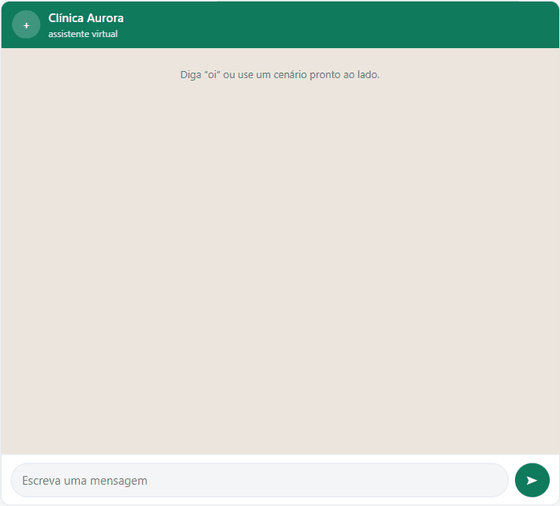
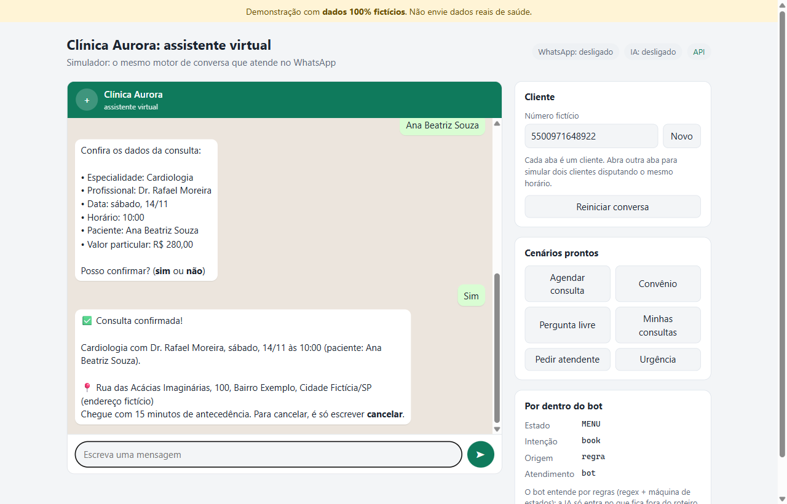
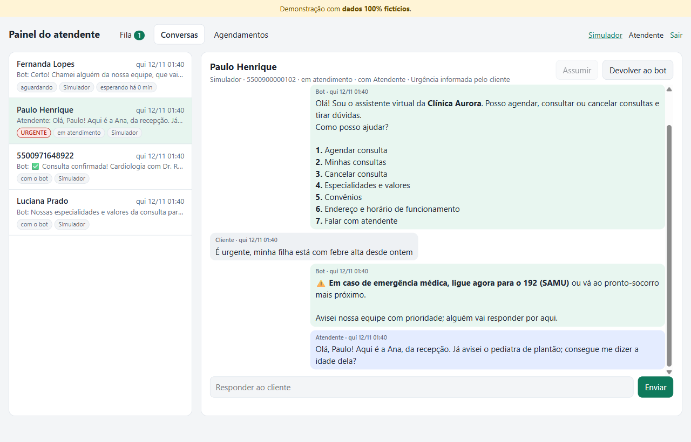
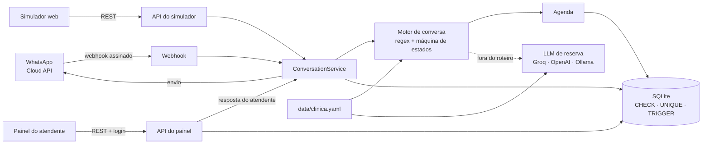

# Assistente virtual de clínica no WhatsApp

[](https://github.com/I-Vicenzo/bot-whatsapp-portfolio/actions/workflows/ci.yml)


Atendente virtual de uma clínica **fictícia**: informa, agenda, consulta, cancela e passa para um humano quando precisa. Regras previsíveis resolvem o roteiro; a IA só entra no que fica de fora, e nunca executa ações.

<p align="center">
  
</p>

## Rodar em 3 comandos

```bash
git clone https://github.com/I-Vicenzo/bot-whatsapp-portfolio.git
cd bot-whatsapp-portfolio
docker compose up
```

- Simulador do cliente: <http://localhost:8000>
- Painel do atendente: <http://localhost:8000/admin> (login de demonstração aparece na tela)
- API documentada: <http://localhost:8000/docs>

Sem `.env`, sobe em modo demo com agenda e conversas de exemplo. WhatsApp e IA ficam desligados e sinalizados na interface.

Para adaptar a outro negócio, edite [data/clinica.yaml](data/clinica.yaml) (nome, endereço, horários, especialidades, convênios, FAQ) e rode `docker compose restart`: a pasta `data` é montada no container, sem rebuild. Um arquivo inválido impede a subida com uma mensagem apontando o campo errado.

## Funcionalidades

**Para o cliente (WhatsApp ou simulador)**

- Agendamento guiado: especialidade, dia (aceita "amanhã", "sexta", "15/11"), horário livre ("14h", "14:30"), nome e confirmação
- Consultar e cancelar as próprias consultas
- Perguntas sobre endereço, horário, convênios, valores e FAQ, inclusive no meio de um agendamento, sem perder o andamento
- "atendente" pausa o bot e coloca a conversa na fila; "urgente" faz o mesmo com prioridade e orienta ligar 192 (SAMU)
- Perguntas fora do roteiro respondidas pela IA só com os dados da clínica; sem resposta nos dados, vai para um humano

**Para a equipe (painel)**

- Fila com urgentes primeiro e tempo de espera; assumir, responder e devolver ao bot
- Histórico com o autor de cada mensagem: cliente, bot, IA ou atendente
- Resposta entregue pelo canal certo; no WhatsApp, bloqueada fora da janela de 24 h
- Agenda com filtros e cancelamento

| Simulador | Painel |
|---|---|
|  |  |

O simulador mostra **por dentro do bot**: estado da conversa, intenção reconhecida e origem da resposta (regra, FAQ, IA). Duas abas do navegador são dois clientes, o que permite mostrar dois clientes disputando o mesmo horário.

## Arquitetura



| Pasta | Conteúdo |
|---|---|
| [app/nlu](app/nlu) | Normalização, intenções por regex e parsers de data, hora, nome e sim/não |
| [app/conversation](app/conversation) | Máquina de estados, textos do bot e `ConversationService` (entrada única de todos os canais) |
| [app/scheduling](app/scheduling) | Horários livres, agendar, consultar e cancelar |
| [app/channels](app/channels) | Simulador e WhatsApp (assinatura, payload, envio com retry) |
| [app/ai](app/ai) | Prompt montado do YAML, cliente compatível com OpenAI, limites de uso |
| [app/admin](app/admin) | Autenticação e API do painel |
| [migrations](migrations) | Alembic, com constraints e triggers escritos à mão |
| [data/clinica.yaml](data/clinica.yaml) | Tudo que é da clínica; trocar o arquivo adapta o bot a outro negócio |

## Decisões técnicas

**Regras antes da IA.** Regex em português e máquina de estados resolvem o roteiro: o comportamento é previsível, testável e não custa nada por mensagem. A IA é reserva para perguntas fora do roteiro. Ela não tem ferramentas, recebe só dados públicos da clínica e, se a resposta afirmar que agendou ou cancelou algo, a resposta é descartada e a conversa vai para um humano.

**Regras de agenda no banco.** O código valida antes para dar boa experiência, mas a última barreira é o SQLite:

- `CHECK` garante a grade de 30 minutos e o formato canônico do horário
- índices únicos parciais (`WHERE status = 'confirmed'`) impedem horário duplicado por especialidade e por paciente; cancelar libera o horário
- triggers recusam horário fora do expediente e sem a antecedência mínima, usando `clinic_now()`, uma função SQL alimentada pelo mesmo relógio injetável do código

Quando dois clientes confirmam o mesmo horário ao mesmo tempo, o índice decide: um confirma e o outro recebe outras opções. Cada regra tem um teste que tenta violá-la direto no banco, e um teste com duas threads disputando o mesmo horário.

**Um motor para todos os canais.** WhatsApp, simulador e painel passam pelo mesmo `ConversationService`. O simulador não é uma imitação: exercita exatamente a lógica de produção.

**Webhook robusto.** Assinatura `X-Hub-Signature-256` conferida sobre o corpo bruto em tempo constante; resposta 200 imediata e processamento em segundo plano; reenvios da Meta descartados pelo id único da mensagem no banco; envio com retry exponencial em 429/5xx.

**Segurança.** Senhas com Argon2; cookie de sessão assinado, HttpOnly e SameSite=Strict (Secure em produção); checagem de `Origin` contra CSRF; limite de tentativas de login e de mensagens do simulador; produção recusa iniciar com senha padrão; conteúdo de clientes nunca vai para `innerHTML`; telefones mascarados e tokens fora dos logs; container sem root.

## WhatsApp real e IA

- **WhatsApp:** passo a passo com número de teste gratuito da Meta, token permanente e túnel HTTPS em [docs/whatsapp-setup.md](docs/whatsapp-setup.md).
- **IA:** crie uma chave gratuita no [Groq](https://console.groq.com/) e configure no `.env`:

  ```dotenv
  LLM_ENABLED=true
  LLM_API_KEY=<sua chave>
  # Opcional: outro provedor compatível com OpenAI
  # LLM_BASE_URL=https://api.openai.com/v1
  # LLM_MODEL=gpt-4o-mini
  ```

  `uv run python -m scripts.eval_llm` roda 20 perguntas, dentro e fora dos dados, contra o provedor real e mostra se cada resposta teve o comportamento esperado.

Todas as variáveis estão em [.env.example](.env.example).

## Desenvolvimento e testes

Requer [uv](https://docs.astral.sh/uv/) e Python 3.14.

```bash
uv sync
uv run uvicorn app.main:create_app --factory --reload   # http://localhost:8000
uv run ruff check && uv run ruff format --check
uv run pytest --cov
```

São mais de 400 testes, com cobertura acima de 95%: diálogos completos (`chat.send("oi")` → resposta e estado), regras do banco, disputa de horário, webhook com a API da Meta simulada (respx), IA com um LLM falso e o painel. O CI roda lint, formatação e testes a cada push.

## Aviso

Todos os dados são **fictícios**: clínica, profissionais, endereço, telefones e convênios. O bot não pede dados clínicos nem dá orientação médica, e em urgência sempre orienta ligar 192. Não use com dados reais de saúde sem adequação à LGPD.

## Próximos passos

- Demo pública hospedada
- Botões e listas interativas do WhatsApp
- Transcrição de áudio (Whisper)
- PostgreSQL via perfil do docker-compose (triggers em PL/pgSQL)
- Lembrete 24 h antes da consulta (template aprovado)
- Bloqueios de agenda (feriados, férias)
- Comando "apagar meus dados" (LGPD)

Roteiro completo e decisões em [PLANO.md](PLANO.md).

## Licença

[MIT](LICENSE)
